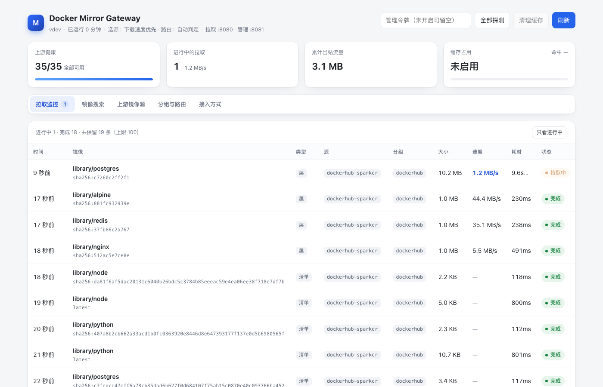
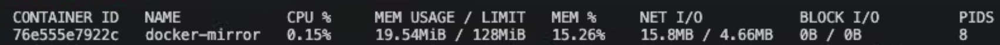

# Docker Mirror Gateway

用 Go 写的容器镜像聚合代理：把多个镜像源聚合成一个地址，按健康度和实测速度自动选源，可选本地缓存。

一个实例同时服务 **Docker Hub、GHCR、Quay、MCR、registry.k8s.io、GCR、Elastic、NVCR**，客户端只需要记住一个地址。

```
Docker / containerd ──▶ Docker Mirror Gateway ──┬──▶ dockerhub 组 ──▶ 镜像源 A（priority 10）
                                                │                 └──▶ 镜像源 B（priority 20）
                                                ├──▶ ghcr 组     ──▶ ghcr.io
                                                ├──▶ quay 组     ──▶ quay.io
                                                └──▶ …           ──▶ 本地缓存（digest 校验 + LRU）
```



## 为什么需要它

在境内拉容器镜像，每个环节都有坑：官方源直连超时；公共加速源今天能用明天 403；GHCR、Quay、K8s 每类仓库要单独找地址单独配置；好不容易配了个快的源，又因为同步滞后拉到了旧版 `latest`。这些问题单靠一个「镜像加速地址」解决不了，Docker Mirror Gateway 把它们当成一个整体来处理：

| 痛点 | 解法 |
| --- | --- |
| 公共加速源随时可能失效，单个源是单点故障 | **多源互备**：一个分组挂多个加速地址，健康检查连续失败自动降级，拉取时逐源重试，切换对客户端无感 |
| 每类仓库都要单独找、单独配加速地址 | **一次聚合**：Hub / GHCR / Quay / MCR / K8s / GCR / Elastic / NVCR 共用同一入口，路径前缀、子域名、自动判定三种路由适配 Docker CLI、containerd、K8s 各种用法 |
| 最快的源未必同步了最新版本，`latest` 拉到旧镜像 | **新旧优先**：拉浮动标签时并发比较各源的构建时间，内容一样才看速度；慢源后台补测不拖累请求 |
| 各源速度差异大且随时间变化，静态 priority 会过期 | **实测选源**：吞吐数据来自真实拉取（零成本）加定期探测，谁的下载体验好就用谁 |
| 官方源必须挂代理才可用，但代理又慢又不能拖累整体 | **源级代理**：官方源单独配 socks5/http 代理作兜底，加速源直连主力，健康探测与拉取走同一代理不出现「探测通过拉不动」 |
| CI 反复拉同一批镜像，回源带宽白白浪费 | **pull-through 缓存**（默认关闭）：本地磁盘或 S3，blob 边传边校验 sha256，digest 永久缓存 |
| 源挂了没人知道，出问题只能翻日志 | **监控通知**：分组健康跌破阈值时经模板化 webhook（GET/POST，协议无关，飞书/企微/自建服务都能适配）或邮件告警，恢复自动通知；控制台实时展示每条拉取与每个上游 |
| Nexus / Harbor 太重，只想给拉镜像提速 | **单二进制约 12 MB**（Releases 压缩包 4~5 MB），直接依赖只有 2 个（yaml、minio-go），不依赖数据库、Redis 或 JVM，空载 CPU 0.15%、内存约 20 MB，`docker compose up` 一键起 |

一句话：**它不是又一个加速地址，而是把「选哪个地址」这件事自动化了。**

## 特性

- **多仓库聚合** — 一个分组下多个互为镜像的加速地址共享同一入口，路径前缀 / 域名 / 自动判定三种路由。
- **按速度选源** — 真实拉取与探测的吞吐动态排序；拉 `latest` 时先比较各源构建时间，不落后版本。
- **健康检查与故障转移** — 定期探测、连续失败自动降级、逐源重试；最近有真实拉取的源直接复用流量数据，不做重复探测。
- **监控通知** — 分组健康跌破阈值时通过模板化 webhook 或邮件告警，默认关闭。
- **pull-through 缓存** — 本地磁盘或 S3，blob 边传边校验（默认关闭）。
- **源级代理** — 每个上游可单独配置 http/socks5 代理（含认证）或强制直连。
- **控制台** — 镜像搜索（含版本号过滤与跳转源页面）、拉取监控（可选落盘，重启不丢）、上游与路由状态。
- **安全** — 拉取与管理端口分离、IP 白名单、adminToken；每个源独立选择「配置账号自动认证」或「客户端凭证透传」，默认不透传，公网多域名部署可为官方源开启透传。
- **轻量** — 单二进制约 12 MB（压缩包 4~5 MB），空载 CPU 不到 1%、内存约 20 MB，树莓派也能长期跑。

更多配置细节见[配置参考](docs/configuration.md)与[运行与运维](docs/operations.md)。

## 资源占用

Go 编译的静态单二进制，无 JVM、无数据库进程；转发大文件走流式零缓冲，内存不随镜像体积增长。日常运行的实测数据（`docker stats`）：



- **CPU 0.15%** — 空载时几乎只有健康探测的开销，且最近有真实拉取的源会跳过探测
- **内存 19.5 MiB** — 并发转发多个大镜像层也稳定在这个量级
- **PIDS 8** — 常驻线程/协程极少，小规格 VPS、NAS、树莓派都放得下

## 快速开始

### 安装

无需自行编译，直接使用现成产物：

- **二进制**：从 [Releases](https://github.com/midaug/docker-mirror-gateway/releases) 下载对应平台的压缩包，解压即用（提供 Linux amd64/arm64/armv7/386、macOS Intel/Apple Silicon、Windows x64/ARM64/x86）
- **Docker 镜像**：[`midaug/docker-mirror-gateway`](https://hub.docker.com/r/midaug/docker-mirror-gateway)，支持 `linux/amd64`、`linux/arm64`、`linux/arm/v7`、`linux/386`；标签与 [Releases](https://github.com/midaug/docker-mirror-gateway/releases) 版本一致，另有 `latest`

```bash
docker pull midaug/docker-mirror-gateway:latest

cp config.example.yaml config.yaml   # 先准备配置，再挂载进容器

docker run -d --name docker-mirror-gateway \
  -p 8080:8080 -p 127.0.0.1:8081:8081 \
  -v docker-mirror-gateway:/var/lib/docker-mirror-gateway \
  -v ./config.yaml:/etc/docker-mirror-gateway/config.yaml:ro \
  midaug/docker-mirror-gateway:latest
```

### Docker Compose

```bash
cp config.example.yaml config.yaml   # 从示例配置开始，按需修改 groups 与镜像源
docker compose up -d --build
docker compose logs -f docker-mirror-gateway
curl -s http://127.0.0.1:8081/api/v1/status | jq .groups
```

- 镜像拉取：`http://127.0.0.1:8080/v2/`
- 控制台：<http://127.0.0.1:8081/>（compose 默认只映射到宿主机回环地址）

国内构建镜像时可指定 Go 模块代理：

```bash
docker compose build --build-arg GOPROXY=https://goproxy.cn,direct
```

### 本地运行

```bash
# 需要 Go 1.23+
go run ./cmd/docker-mirror-gateway -config config.yaml
# 或者
make build && ./bin/docker-mirror-gateway -config config.yaml
```

不带 `-config` 时依次查找 `./config.yaml`、`/etc/docker-mirror-gateway/config.yaml`，都没有则使用内置默认配置（仅官方 Docker Hub）。

## 接入 Docker

编辑 `/etc/docker/daemon.json`，重启 Docker 后 `docker pull alpine:latest` 自动走 dockerhub 组：

```json
{
  "registry-mirrors": ["http://127.0.0.1:8080"],
  "insecure-registries": ["127.0.0.1:8080"]
}
```

其他仓库（GHCR、Quay 等）与 containerd / K8s / Podman 的接入方式、HTTPS 反代见[路由与客户端接入](docs/routing.md)。

## 默认配置

`config.example.yaml` 预置了 8 个分组、35 个境内公共加速源，开箱即用：按实测速度动态排序，官方源配好兜底优先级，健康检查自动降级失效源。明细见[配置参考 · 内置加速源](docs/configuration.md#内置加速源)。

## 文档

| 文档 | 内容 |
| --- | --- |
| [路由与客户端接入](docs/routing.md) | 路径前缀 / 域名 / 自动判定、Docker / containerd / nerdctl / Podman 接入、HTTPS 反代 |
| [配置参考](docs/configuration.md) | 全部配置项、端口分离、源级代理、内置加速源 |
| [运行与运维](docs/operations.md) | 选源与健康检查、监控通知、缓存、访问控制、控制台、管理接口与指标 |
| [常见问题](docs/faq.md) | 排查与 FAQ |

## 开发

```bash
make test     # go test ./...
make vet      # go vet ./...
make fmt      # gofmt
make build    # 产出 bin/docker-mirror-gateway
make up       # docker compose up -d --build
```

## 说明

`config.example.yaml` 中的公共镜像源仅作示例，请替换为你有权使用、且服务条款允许的源；生产环境请自建或使用官方源，并遵守对应仓库的速率与使用政策。

## 许可证

[MIT](LICENSE) © 2026 midaug

