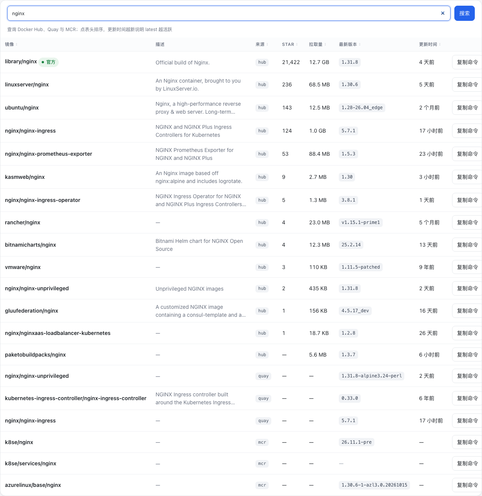

# 运行与运维

选源与健康检查、监控通知、缓存、访问控制、控制台与管理接口。

## 选源与健康检查

每个上游维护 `healthy`、连续失败次数、延迟、吞吐 EWMA 与最近错误。

默认按下载速度选源（`selection.strategy: speed`），排序规则：

1. 健康的上游永远排在失效源之前（失效源只作最后兜底）；
2. 吞吐高者优先；
3. 吞吐相差在 `speedTolerance`（默认 25%）以内视为持平，此时比较延迟；
4. 仍持平则比 `priority`。

吞吐来自真实拉取（零成本）与主动探测（每 30 分钟补一次样本，让未被选中的源也能刷新）。小样本（< 64KB）不参与计算，计时只覆盖 body 传输。

```yaml
selection:
  strategy: speed          # speed | priority | latency
  speedProbeBytes: 262144
  speedProbeInterval: 30m
  speedTolerance: 0.25
```

### latest 的新旧优先

各加速源同步上游有延迟，最快的源未必有最新的 `latest`。开启 `selection.preferFresh` 后，拉取 `latest` 时会并发比较各健康上游的镜像构建时间（`config.created`）：

1. 各源 manifest digest 完全一致 → 内容相同，直接按速度选，不再下载配置；
2. 否则构建时间新的优先，差异小于 `freshnessTolerance` 时才比速度；
3. 有效样本少于两个 → 退回速度排序。

探测结果按 `freshnessTTL` 缓存，常见情况下只多花几百毫秒，同一仓库 10 分钟内不重复探测。代价是每个仓库每 10 分钟第一次拉 latest 最多多等约 0.8 秒。

超过 0.8 秒还没返回的源（例如挂在代理后面的官方源，单次 manifest 就要 1~3 秒）不会拖住这次请求：本次按原策略选源，探测转到后台继续跑，跑完写入缓存，后续十分钟内就能参与比较。

```yaml
selection:
  preferFresh: true          # 关掉则完全按速度选源
  freshTags: ["latest"]      # 也可以加上 stable、edge 等浮动标签
  freshnessTolerance: 0s     # 0 = 严格优先更新的
  freshnessTTL: 10m
```

> 版本号标签（`1.27`、`v2.3.1`）默认不参与比较，各源之间通常一致。

### 健康判定

后台每 `health.interval` 探测 `/v2/` 与探针镜像的 manifest（验证 token 与拉取链路）。连续失败 `failThreshold` 次标记不可用，成功一次立即恢复；真实流量中的 5xx / 429 / 超时也计入失败，404 / 401 / 403 不计入。

一次拉取中若当前源返回 5xx 或连不上，会立刻尝试下一个源，客户端无感知。

`health.trafficWindow`（默认 `2m`）内处理过成功真实拉取的上游会跳过定时探测：真实流量已经测出延迟、喂了吞吐样本、并由成败维护着健康状态，再发探测请求是纯开销。窗口内上游若真挂了，真实拉取的连续失败同样会把它降级；窗口过后恢复主动探测。控制台的「探测」按钮不受窗口限制，始终实测。

## 监控通知

默认关闭。开启后可以在分组健康跌破阈值时收到告警，恢复后自动通知：

```yaml
notify:
  enabled: true
  interval: 30m            # 持续异常时的重复提醒间隔；触发与恢复始终立即发
  webhooks:
    - method: POST         # 飞书自定义机器人：body 模板适配其消息格式
      url: https://open.feishu.cn/open-apis/bot/v2/hook/xxx
      body: '{"msg_type":"text","content":{"text":"{{.TextJSON}}"}}'
    - method: POST         # 企业微信群机器人
      url: https://qyapi.weixin.qq.com/cgi-bin/webhook/send?key=xxx
      body: '{"msgtype":"text","text":{"content":"{{.TextJSON}}"}}'
    - method: GET          # 自建服务：只通过 query 传参
      url: https://ops.example.com/hooks/mirror?group={{.Group}}&state={{.State}}

groups:
  - name: dockerhub
    notify:
      enabled: true
      minHealthy: 1        # 健康源少于 1（即全部不可用）时告警
```

- webhook 协议无关：`url` 与 `body` 都是模板（text/template 语法），支持变量替换，因此飞书、企业微信或任何自定义协议都能通过模板适配。
- `method` 支持 `GET` / `POST`（默认 `POST`）：GET 只替换 `url` 模板；POST 替换 `url` 与 `body`，`body` 留空时发送结构化 JSON（`group`/`state`/`healthy`/`total`/`threshold`/`failing`/`time` 字段）。
- 模板变量：`{{.Title}}`（单行标题）、`{{.Text}}`（完整多行文本）、`{{.TextJSON}}`（JSON 转义文本，写在模板引号内）、`{{.State}}` / `{{.StateText}}`、`{{.Group}}` / `{{.Healthy}}` / `{{.Total}}` / `{{.Threshold}}` / `{{.Time}}` / `{{.Failing}}`。URL 模板中的值自动做 URL 转义。
- 模板非法会在启动时直接报错，不会运行期静默丢消息。
- 也支持 SMTP 邮件（`notify.email`）：465 端口走隐式 TLS，587/25 尝试 STARTTLS；中文主题按 RFC 2047 编码。
- 发送在后台完成且带独立超时，通道故障不影响拉取与探测；发送失败只记日志，下一轮评估会重试。
- 频率控制：状态变化（告警触发、恢复）始终立即通知；持续异常期间每 `interval` 重发一次提醒，不会刷屏。

## 缓存

缓存默认关闭，需要提速或省回源带宽时再开：

```yaml
cache:
  enabled: true
  backend: disk      # 或 s3
```

### 本地磁盘

```
data/
├── activity.json                       拉取监控记录（data.persist=true 时才有）
└── cache/
    ├── blobs/sha256/<前2位>/<完整 hex>  blob 内容，按 digest 寻址
    └── manifests/<hash 前2位>/<hash>.bin  manifest 原始字节
                              <hash>.json 元数据
```

`activity.json` 最多保留 1000 条，控制台只显示最近 100 条；记录变化后节流写盘，退出时再保存一次。默认 `data.persist: false` 时不会有这个文件。

- blob 用 `io.TeeReader` 边传边校验 sha256，通过才落盘；客户端中断则丢弃临时文件。
- manifest 缓存键包含分组名与 Accept 变体，避免不同仓库的同名镜像、多架构清单与单平台清单互相覆盖。
- tag 有 TTL，digest 永久有效。
- 超过容量上限按最久未访问淘汰到 85%。

### S3 对象存储

```yaml
cache:
  enabled: true
  backend: s3
  maxSizeGB: 0          # 0 = 不限制
  s3:
    endpoint: "minio.example.com:9000"
    bucket: "docker-mirror-gateway"
    accessKey: "${S3_AK}"
    secretKey: "${S3_SK}"
    prefix: "docker-mirror-gateway"
    useSSL: true
    pathStyle: true     # 自建 MinIO 一般要开
```

适配 MinIO、OSS、COS、OBS 等 S3 兼容服务。blob 先落本地临时文件，校验通过后异步上传，上传慢不影响客户端。`prefix` 一定要保留，清理与淘汰只碰这个前缀。

## 访问控制

```yaml
access:
  allow: ["192.168.0.0/16", "10.0.0.0/8", "100.64.0.1"]
  deny:  ["192.168.5.5"]
  trustForwardedFor: false
```

- 支持单 IP 与 CIDR，IPv4 / IPv6；`allow` 为空表示只按 `deny` 拦。
- `deny` 优先；被拒时返回 403 与 registry 规范的错误体。
- 只作用于拉取端口，`/healthz`、`/readyz` 不受限制。
- `trustForwardedFor` 默认关闭：`X-Forwarded-For` 可伪造，只有前面确实挂了反向代理时才开。开启后取链尾地址（最靠近网关的可信代理追加的真实客户端 IP），客户端伪造的链首值不生效。

## 控制台



- **镜像搜索** — 搜 Docker Hub、Quay 与 MCR，结果带 Star、拉取量、最新版本号与更新时间，任意列可点击排序；悬浮版本号能看到最近更新的 10 个标签，支持 `nginx:1.31.8` 这样带版本号的搜索（只保留确实拥有该版本的仓库），点击镜像名跳转到对应源上的仓库页。
- **拉取监控** — 最近 100 条传输记录，含镜像、命中的源、分组、大小、实时速度、耗时与状态，正在传输的排最上面。
- **上游镜像源** — 按分组切子标签，组内名次、状态、速度、延迟、用量一览；地址与代理列限宽展示，悬浮查看完整地址，最近错误以图标展示。
- **分组与路由 / 接入方式** — 分组健康度、路由缓存，以及可直接复制的客户端配置。

## 拉取端兼容接口

除 `/v2/` 外，拉取端口还实现了两个旧客户端常用的接口：

| 方法 | 路径 | 说明 |
| --- | --- | --- |
| GET | `/v1/search?q=nginx&n=25&page=1` | Docker Registry v1 搜索，结果来自与控制台相同的多源搜索（受 `search.enabled` 控制） |
| GET | `/v2/_catalog?n=100&last=...` | 仓库目录：拉取记录中出现过的仓库名去重、按名称排序，支持 `n` / `last` 分页 |

这两个端点的主要用途是兼容群晖 Docker（DSM / Container Manager）的注册表搜索：它先请求 `/v2/_catalog` 拿已加载的镜像仓库，再用 `/v1/search?q=...` 搜索 Hub 仓库，缺了就会显示搜索为空或列表加载失败。其他 NAS、面板类镜像界面同理。两者与 `/v2/` 一样受 IP 白名单约束。

## 管理接口与监控

| 方法 | 路径 | 说明 |
| --- | --- | --- |
| GET | `/` | 控制台页面 |
| GET | `/api/v1/status` | 分组、路由、缓存、上游状态 |
| GET | `/api/v1/upstreams` | 上游与分组状态 |
| POST | `/api/v1/upstreams/{name}/probe` | 立即探测某个上游 |
| GET | `/api/v1/routes` | 查看路由缓存 |
| DELETE | `/api/v1/routes` | 清空路由缓存 |
| GET | `/api/v1/resolve?repo=ghcr.io/owner/app` | 排查仓库会落到哪个分组 |
| GET | `/api/v1/resolve?repo=owner/app&probe=1` | 同时展示各分组的探测结果 |
| GET | `/api/v1/search?q=nginx` | 搜索镜像 |
| GET | `/api/v1/activity?limit=100` | 最近的拉取记录与汇总 |
| POST | `/api/v1/cache/gc` | 手动执行一次清理/淘汰 |
| POST | `/api/v1/cache/purge` | 清空缓存（谨慎） |
| GET | `/metrics` | Prometheus 文本格式指标 |
| GET | `/healthz` | 存活检查（始终 200） |
| GET | `/readyz` | 就绪检查（全部上游失效时 503） |

以上接口默认只在管理端口提供；未配置 `server.adminAddr` 时与拉取端口共用。需要鉴权的接口使用 `X-Admin-Token: <adminToken>` 或 `Authorization: Bearer <adminToken>`。

```bash
curl -s 'http://127.0.0.1:8081/api/v1/resolve?repo=stefanprodan/podinfo' | jq
# { "repo": "stefanprodan/podinfo", "group": "ghcr", "upstreamRepo": "stefanprodan/podinfo", "via": "detect" }
```

常用指标：

```
mirror_gateway_upstream_healthy{group="ghcr",upstream="ghcr"} 1
mirror_gateway_upstream_latency_ms{group="ghcr",upstream="ghcr"} 465.4
mirror_gateway_route_cache_entries 5
mirror_gateway_cache_hits_total 8
mirror_gateway_http_requests_total{kind="manifest",method="GET",status="200"} 4
```
